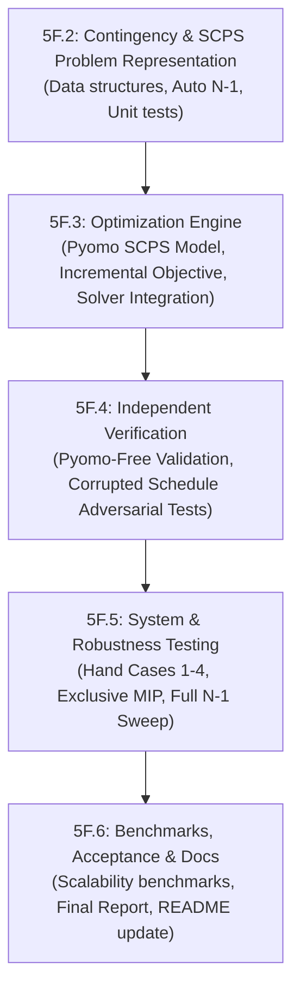

# Stage 5F — Security-Constrained Preventive Scheduling (SCPS)
## Technical Implementation Plan (Milestone 5F.2)

**Branch:** `stage-5f-work-in-progress`  
**Date:** 2026-11-04  
**Author:** GridMind Optimization Engineering  
**Authoritative Specification:** [`GridMind/STAGE5F_SPEC.md`](./STAGE5F_SPEC.md) (Revision 3)  
**Status:** DRAFT — Awaiting approval before proceeding to code implementation  

---

> [!IMPORTANT]
> This document is a **planning-only deliverable**. In accordance with Stage 5F preservation rules, no production code, tests, configuration, or existing documentation are modified in this milestone.

---

## 1. Inspection and Baseline Synthesis

A rigorous inspection of GridMind's core backend components confirms the architecture, boundaries, and extension points:

### 1.1 Existing Model Characteristics & Verified Interfaces

1. **`gridmind.network`:**
   - Entities: `Node` (`id`, `demand_mw`), `Generator` (`id`, `node`, `capacity_mw`, `cost_per_mwh`, `renewable`, `availability_mw`, `online`, `ramp_up_mw`, `ramp_down_mw`), `Line` (`id`, `from_node`, `to_node`, `capacity_mw`, `in_service`), `Network` (`nodes`, `generators`, `lines`, `unmet_penalty_per_mwh`, `interval_hours`).
   - Lookups: `net.node(id)`, `net.generator(id)`, `net.line(id)`.
   - Physics: Lossless capacity-constrained transportation flow (directed graph with flow bounds $[-F, F]$). No line reactances, susceptances, or phase angles exist.

2. **`gridmind.multiperiod`:**
   - Entities: `Battery` (`id`, `node`, `capacity_mwh`, `max_charge_mw`, `max_discharge_mw`, `eta_charge`, `eta_discharge`, `initial_soc_mwh`, `min_soc_mwh`, `final_soc_mwh`, `throughput_cost_per_mwh`), `Horizon` (`periods`, `step_hours`, `demand_mw[t][n]`, `availability_mw[t][g]`, `generator_online[t][g]`, `line_in_service[t][l]`), `ScheduleProblem` (`network`, `horizon`, `batteries`, `initial_dispatch_mw`, `tiebreak_epsilon`).

3. **`gridmind.scheduling`:**
   - Solver execution: `solve_schedule(problem, allow_unmet=True, validate=True, battery_mode="lp", fixed_battery_mw=None)`.
   - Result: `ScheduleResult` containing solver metrics, operating cost decomposition, trajectory mappings (`dispatch`, `flows`, `unmet`, `charge`, `discharge`, `soc`), and an independent `ValidationReport`.
   - Continuous and MIP exclusivity modes (`"lp"`, `"exclusive"`).

4. **`gridmind.validation`:**
   - `validate_schedule(...)` re-derives all physical and model constraints directly from raw problem data and returns a structured `ValidationReport` containing discrete `Check` objects. Pyomo constraint structures are deliberately bypassed.
   - Cost recomputation: `recompute_schedule_costs(...)` verifies exact consistency between reported objective and physical trajectory integrals.

5. **`gridmind.solver`:**
   - Candidate chain resolution (`glpk` -> `cbc` -> `appsi_highs`) via `resolve_solver(mip=...)`.
   - Explicit failure handling via `SolverUnavailableError`.

---

## 2. Mathematical-to-Code Mapping

Every mathematical structure in `STAGE5F_SPEC.md` maps directly to concrete Pyomo components and independent verification routines:

| Specification Element | Mathematical Notation | Pyomo Representation | Verification Check |
|---|---|---|---|
| **Preventive Decision Variables** | $p^0_{g,t}, f^0_{\ell,t}, u^0_{n,t}$<br>$ch^0_{b,t}, dis^0_{b,t}, e^0_{b,t}$ | `m.p0[g, t]`, `m.f0[l, t]`, `m.u0[n, t]`<br>`m.ch0[b, t]`, `m.dis0[b, t]`, `m.e0[b, t]` | `prev_generator_limits`, `prev_line_capacity`, `prev_power_balance`, `prev_battery_power`, `prev_battery_soc` |
| **Contingency Decision Variables** | $p^k_{g,t}, f^k_{\ell,t}, u^k_{n,t}$<br>$ch^k_{b,t}, dis^k_{b,t}, e^k_{b,t}$ | `m.pk[k, g, t]`, `m.fk[k, l, t]`, `m.uk[k, n, t]`<br>`m.chk[k, b, t]`, `m.disk[k, b, t]`, `m.ek[k, b, t]` | `corr_generator_limits`, `corr_line_capacity`, `corr_power_balance`, `corr_battery_power`, `corr_battery_soc` |
| **Preventive Constraints** | $p^0 \le \bar{P}$, $\|f^0\| \le F$, Nodal Balance, Ramp, SoC | Same as `scheduling.py:build_schedule_model` applied to index $0$ | Reused from `validation.py` baseline logic |
| **N-1 Generator Outage** | $\bar{P}^k_{g,t} = \bar{P}_{g,t}(1 - \delta^G_{g,k})$ | For $g = g_k$: `m.pk[k, g_k, t] == 0.0`<br>For $g \ne g_k$: `m.pk[k, g, t] <= gen_limit[g, t]` | `corr_outage_zero`, `corr_generator_limits` |
| **N-1 Line Outage** | $F^k_{\ell,t} = F_{\ell,t}(1 - \delta^L_{\ell,k})$ | For $\ell = \ell_k$: `m.fk[k, \ell_k, t] == 0.0`<br>For $\ell \ne \ell_k$: `abs(m.fk[k, \ell, t]) <= line_cap[\ell, t]` | `corr_outage_zero`, `corr_line_capacity` |
| **Corrective Ramp (Exemption R1)** | $p^k_{g,t} - p^0_{g,t} \le RU_g$<br>$p^0_{g,t} - p^k_{g,t} \le RD_g$<br>$\forall g \ne g_k$ | Constraint applied only over $\{g \in \mathcal{G}^{ramp} \mid g \ne g_k\}$ | `corr_ramp_limits`: asserts $|p^k - p^0| \le ramp$ for surviving units, asserts $p^k_{g_k} == 0$ without bounding $p^0 - p^k$ by $RD$ |
| **Battery Initial SoC (A2)** | $e^k_{b,-1} \equiv E^0_b$ | `m.ek[k, b, 0] == bat_soc0[b] + ...`<br>(No terminal SoC required in corrective stage) | `corr_battery_soc`: verifies step dynamics starting from $E^0_b$ |
| **Incremental Recourse Objective** | $C^{prev} + \frac{1}{\|\mathcal{K}\|} \sum_k \Delta C^k$ | Pyomo `m.total_cost = Objective(expr=C_prev + C_cont_incr, sense=minimize)` | `objective_consistency`: independently recomputed from schedule arrays to relative tol $10^{-6}$ |
| **Strict Security Enforcement** | $u^0_{n,t} = 0$, $u^k_{n,t} = 0$ | Variable bounds clamped to $0.0$ or equality constraints `u == 0.0` | `no_unmet_in_strict_mode`: asserts $\max(u) \le 10^{-5}$ across all $n, t, k$ |

---

## 3. Proposed Architecture

To preserve maintainability, modular separation, and zero breaking changes to existing multi-period or stochastic workflows, the SCPS implementation will introduce **one new core module** and **extend one existing validation module**:

```
gridmind/
├── security.py          <-- NEW: Contingency representation, SCPSProblem, SCPSResult, build/solve SCPS model
├── validation.py        <-- EXTENDED: ContingencyVerification, SCPSVerificationReport, verify_contingency_schedule
└── ...                  <-- UNTOUCHED: network, multiperiod, scheduling, stochastic, control, resilience
```

### 3.1 Data Structures (`gridmind/security.py`)

```python
@dataclass(frozen=True)
class Contingency:
    """A single N-1 contingency definition."""
    id: str                    # Unique identifier, e.g. "gen:gas-north", "line:line-1"
    kind: str                  # "generator" or "line"
    component_id: str          # Target generator or line ID
    name: str = ""

    def validate(self, network: Network) -> None:
        """Validate component exists in network and is of declared kind."""
        if self.kind == "generator":
            network.generator(self.component_id)
        elif self.kind == "line":
            network.line(self.component_id)
        else:
            raise ValueError(f"Invalid contingency kind: {self.kind!r}; must be 'generator' or 'line'")


@dataclass(frozen=True)
class ContingencySet:
    """A validated collection of N-1 contingencies."""
    contingencies: tuple[Contingency, ...]

    @classmethod
    def auto_n_1(cls, network: Network, include_generators: bool = True, include_lines: bool = True) -> "ContingencySet":
        """Generate canonical N-1 contingency set for all in-service network elements."""
        ...


@dataclass(frozen=True)
class SCPSProblem:
    """Security-Constrained Preventive Scheduling Problem definition."""
    problem: ScheduleProblem               # Base multi-period problem
    contingency_set: ContingencySet        # Selected N-1 contingencies
    notes: str = ""

    def validate(self) -> None:
        """Validate base problem and contingency set.

        Rejects an empty contingency set when N-1 security assessment is requested.
        Weights are fixed to 1 / len(contingency_set.contingencies) as an internal
        optimization convention in accordance with Stage 5F.1 specifications.
        """
        self.problem.validate()
        self.contingency_set.validate(self.problem.network)
        if len(self.contingency_set.contingencies) == 0:
            raise ValueError("SCPSProblem requires a non-empty contingency_set for N-1 security assessment")
```

> [!NOTE]
> **Equal Weighting Scope Decision:**
> Configurable custom contingency weights are intentionally omitted from `SCPSProblem`.
> In accordance with `STAGE5F_SPEC.md` Section 6.4, equal weighting $w_k = 1 / |\mathcal{K}|$
> is applied as a scale-invariant optimization convention rather than empirical outage probabilities.
> Independent N-1 feasibility verification remains strictly decoupled from these weights. Rejecting
> empty contingency sets ensures that an N-1 assessment cannot vacuously succeed without evaluating any outages.

### 3.2 Optimization Result Structure (`gridmind/security.py`)

```python
@dataclass
class ContingencySchedule:
    """Corrective dispatch trajectory for one contingency."""
    contingency: Contingency
    dispatch: dict[str, list[float]]
    flows: dict[str, list[float]]
    unmet: dict[str, list[float]]
    charge: dict[str, list[float]]
    discharge: dict[str, list[float]]
    soc: dict[str, list[float]]
    incremental_cost_usd: float
    unmet_energy_mwh: float
    is_secure: bool


@dataclass
class SCPSResult:
    """Complete outcome of an SCPS solve."""
    status: str                         # "optimal", "infeasible", "error", "solver_unavailable"
    solver: str
    termination_condition: str
    message: str
    runtime_seconds: float
    n1_secure: bool                     # True iff ALL contingencies have 0 unmet demand
    
    # Cost accounting
    total_objective_usd: float | None
    preventive_operating_cost_usd: float | None
    preventive_generation_cost_usd: float | None
    preventive_unmet_penalty_usd: float | None
    preventive_battery_throughput_usd: float | None
    preventive_tiebreak_usd: float | None
    corrective_redispatch_cost_usd: float | None
    contingency_unmet_penalty_usd: float | None
    corrective_battery_throughput_usd: float | None
    contingency_tiebreak_usd: float | None
    contingency_cost_usd: float | None   # Sum of corrective deltas
    
    # Schedules
    preventive_result: ScheduleResult   # Base schedule
    contingencies: dict[str, ContingencySchedule]  # contingency_id -> corrective schedule
    
    # Verification
    validation: SCPSVerificationReport | None = None

    @property
    def ok(self) -> bool:
        return self.status == "optimal" and (self.validation is None or self.validation.passed)
```

### 3.3 Independent Verifier Extension (`gridmind/validation.py`)

In full alignment with Section 8 of `STAGE5F_SPEC.md`, `validation.py` will be extended with:
- `ContingencyVerification`: per-contingency checks, unmet energy, and security determination.
- `SCPSVerificationReport`: composite report holding preventive checks, contingency checks, and overall `n1_secure` status.
- `verify_contingency_schedule(...)`: standalone validation logic that checks the corrective schedule against network data, component limits, ramp limits (with the trip exemption), power balance, and recomputed objective.

---

## 4. Test Strategy and Matrix

The testing strategy is structured into distinct, independently executable test categories in `tests/test_security.py` and `tests/test_security_validation.py`:

```
=====================================================================================================
Test Category                 Scenarios / Test Cases                                      File
=====================================================================================================
1. Contingency Repr.          - Contingency validation (valid/invalid kind/component)    tests/test_security.py
                              - Auto N-1 generation across generators & lines
                              - Serialization round-trip (to_dict / from_dict)
-----------------------------------------------------------------------------------------------------
2. Deterministic Hand Cases   - Case 1: Line outage leading to islanding (Infeasible)     tests/test_security.py
                              - Case 2: Outage of g2, line & capacity bound (Infeasible)
                              - Case 3: Ramp-constrained recovery (Infeasible)
                              - Case 4: Battery-assisted recovery (Feasible & Infeasible)
-----------------------------------------------------------------------------------------------------
3. Mathematical Invariants    - Tripped generator immediate trip (p^k = 0, no RD bound)  tests/test_security.py
                              - Surviving generator ramp bounds (|p^k - p^0| <= RU/RD)
                              - Battery shared initial state (e^k starts at E0)
                              - Zero incremental cost when corrective schedule == base
-----------------------------------------------------------------------------------------------------
4. Security Mode Policies     - Strict mode: infeasible when any contingency fails        tests/test_security.py
                              - Penalized mode: returns optimal status with n1_secure=False
                              - Decoupling of n1_secure from objective weights
-----------------------------------------------------------------------------------------------------
5. Independent Validation     - Corrupted generator output > cap -> FAIL                  tests/test_security_validation.py
                              - Corrupted line flow > cap -> FAIL
                              - Corrupted nodal balance -> FAIL
                              - Violated surviving ramp limit -> FAIL
                              - Tripped generator producing power -> FAIL
                              - Fabricated objective mismatch -> FAIL
-----------------------------------------------------------------------------------------------------
6. Multi-Period & Fleet       - Multi-period horizon with renewable profiles & batteries  tests/test_security.py
                              - Exclusivity mode MIP integration
                              - 8-node sample network full N-1 contingency sweep
=====================================================================================================
```

---

## 5. Phased Implementation Sequence

The implementation is broken into 5 manageable, reviewable sub-milestones:



### Milestone 5F.2: Contingency & SCPS Problem Representation
- **Source changes:** Create `gridmind/security.py` (classes: `Contingency`, `ContingencySet`, `SCPSProblem`).
- **Tests:** Add `tests/test_security.py` covering element validation, auto-generation of generator/line contingency sets, duplicate detection, and serialization.
- **Acceptance:** 100% test pass on new data structures without touching solver or model logic.

### Milestone 5F.3: Monolithic SCPS Optimization Engine
- **Source changes:** Implement `build_scps_model` and `solve_security_constrained` in `gridmind/security.py`.
- **Model details:**
  - Build preventive blocks ($0$) and contingency blocks ($k \in \mathcal{K}$).
  - Link surviving generators via corrective ramp constraints; exempt failed generator $g_k$.
  - Formulate incremental objective: $C^{prev} + \frac{1}{|\mathcal{K}|} \sum_k \Delta C^k$.
  - Implement strict mode ($u=0$) vs. penalized mode ($u \ge 0$ with penalty $\lambda$).
- **Tests:** Hand-calculated Cases 1–3 in `tests/test_security.py`. Verify that solver status and schedule extraction match specification numbers.

### Milestone 5F.4: Independent Contingency Verifier
- **Source changes:** Extend `gridmind/validation.py` with `verify_contingency_schedule`, `ContingencyVerification`, and `SCPSVerificationReport`.
- **Tests:** Create `tests/test_security_validation.py`. Add adversarial/corrupted schedule tests (tampered generation, tampered ramp, invalid flow, corrupted outage).
- **Acceptance:** Verifier successfully catches every perturbation without accessing Pyomo model components.

### Milestone 5F.5: Comprehensive System & Robustness Testing
- **Source changes:** Refinements to `gridmind/security.py` for edge cases (islanding, zero demand, ramp-unconstrained generators, battery exclusivity).
- **Tests:** Hand-calculated Case 4 (battery recovery), multi-period 24h sample network N-1 sweeps, strict mode failure propagation, exclusive MIP battery mode. Full regression run of existing test suite (all non-pandas tests passing).

### Milestone 5F.6: Benchmarks, Acceptance & Documentation
- **Source changes:** Create `benchmarks/security_bench.py` and final acceptance report `STAGE5F_ACCEPTANCE_REPORT.md`.
- **Benchmarks:** Measure build time, solve time, variable count, constraint count across Small (3 nodes), Medium (6 nodes), and Large (10 nodes) networks.
- **Acceptance:** Formal Stage 5F sign-off report with reproducible evidence.

---

## 6. Key Design Decisions & Risk Mitigation

1. **Monolithic Model Scalability vs. Simplicity:**
   - *Decision:* Monolithic Pyomo formulation is approved for 5F.3.
   - *Risk:* Solve times grow as $O(|\mathcal{K}| \cdot T)$.
   - *Mitigation:* The benchmark harness will explicitly track model construction and solve time across contingency counts. If solve times exceed practical limits on larger systems, a Benders decomposition interface can be slotted in as an alternative solver strategy without changing the public `SCPSProblem` or `SCPSResult` signatures.

2. **Battery Exclusivity in Corrective Stage:**
   - *Decision:* In `battery_mode="exclusive"`, binary variables $z^k_{b,t}$ are introduced per contingency.
   - *Risk:* Increases branch-and-bound tree size linearly with $|\mathcal{K}|$.
   - *Mitigation:* Maintain default `battery_mode="lp"`; verify MIP performance on standard 8-node test network during 5F.5.

3. **Decoupling Feasibility from Objective Value & Empty Contingency Set Policy:**
   - *Decision:* The result property `n1_secure` is populated strictly by the verifier (`all(c.n1_secure for c in contingency_results)`), never inferred directly from Pyomo's `TerminationCondition.optimal`.
   - *Decision:* Custom contingency weights are omitted from `SCPSProblem` in favor of uniform $1 / |\mathcal{K}|$ scaling. Empty contingency sets are rejected by `SCPSProblem.validate()` to guarantee that an N-1 assessment cannot vacuously pass without evaluating contingencies. This is a deliberate initial scope boundary, not a mathematical divergence.

---

## 7. Deliverable Verification Checklist

- [x] Mathematics aligned with approved `STAGE5F_SPEC.md` (Rev 3).
- [x] No modification of existing Python source files or test suites during this planning phase.
- [x] Preserved existing network transportation-flow model boundary (no AC/DC power-flow claims).
- [x] Phased implementation breakdown with explicit acceptance criteria.
